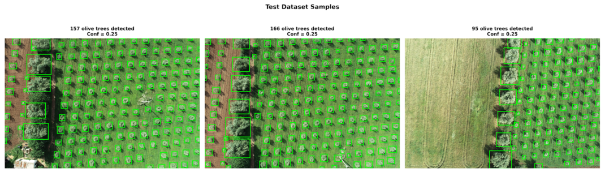
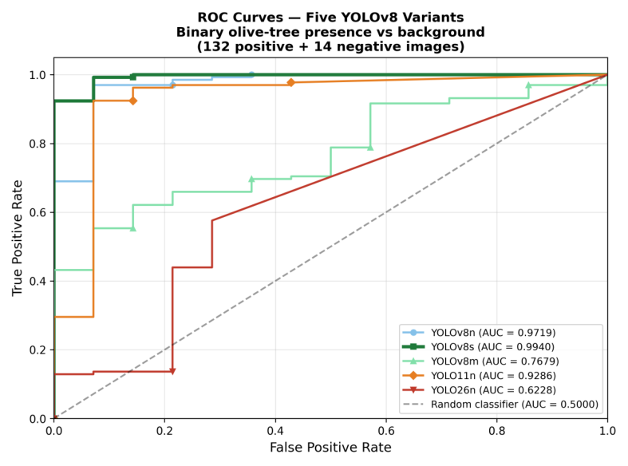
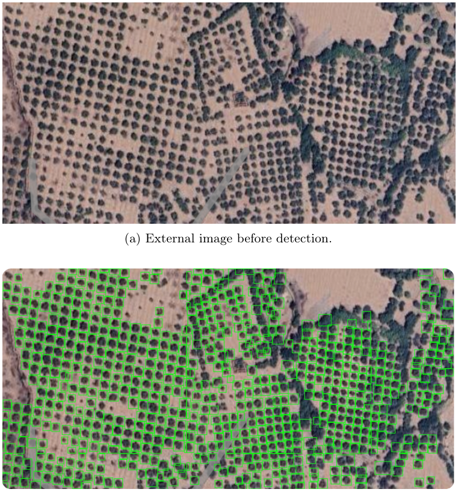

# Atlas Oliva : détection et comptage d'oliviers par YOLOv8

Plateforme web sécurisée qui détecte et compte automatiquement les oliviers sur des images aériennes (drone ou satellite).
Le Maroc compte plus d'un million d'hectares d'oliveraies, et le comptage manuel des arbres est long et sujet aux erreurs :
Atlas Oliva l'automatise et l'intègre dans une application traçable, avec authentification et historique des analyses.

Projet de fin de semestre (PFS), ENSA Marrakech, filière GCDSTE, juillet 2026. Équipe de 2 : **Sara Jamiri** (IA et backend) et Malak Lahnine.
Le projet a fait l'objet d'un article scientifique, disponible dans [`article/`](article/Atlas-Oliva-article.pdf).

## Résultats

YOLOv8s a été retenu après la comparaison de cinq modèles, entraînés dans des conditions identiques :

| Modèle | mAP@0.5 | Précision | Rappel | F1 | Inférence (ms) | ROC-AUC |
|---|---|---|---|---|---|---|
| YOLOv8n | 94,2 % | 91 % | 89 % | 90 % | 6,7 | 0,9719 |
| **YOLOv8s** | **95,4 %** | **93 %** | **92 %** | **92 %** | **4,5** | **0,9940** |
| YOLOv8m | 94,5 % | 92 % | 91 % | 91 % | 10,0 | 0,7679 |
| YOLO11n | 94,1 % | 91 % | 89 % | 90 % | 5,0 | 0,9286 |
| YOLO26n | 91,7 % | 88 % | 86 % | 87 % | 12,3 | 0,6228 |

Temps d'inférence pour une image 640 × 640 sur GPU Tesla T4.

Pour le comptage, l'erreur absolue moyenne (MAE) de YOLOv8s est de **3,60 arbres par image** sur les images pleine résolution,
et de **5,17 arbres par image** sur l'ensemble du jeu de test multi-échelle (132 images).

## Méthode

1. **Jeu de données harmonisé de 741 images** : 46 images drone haute résolution d'OliveTreeCrownsDb et 695 images de
   [Olive Trees Detection v1](https://universe.roboflow.com/saras-workspace-ju8qv/olive-trees-c9fji/1) (Roboflow),
   classes unifiées en `olive_tree` au format YOLO.
2. **Découpage sans fuite de données** : 463 images d'entraînement, 146 de validation, 132 de test. Les images quasi
   identiques issues d'un même vol sont placées dans le même sous-ensemble.
3. **Entraînement** : entrée 640 × 640, batch de 8, 50 époques avec arrêt anticipé (patience de 10), optimiseur AdamW,
   Ultralytics sur Google Colab (GPU T4).
4. **Inférence par tuiles** pour les grandes images : découpage en tuiles de 640 × 640, seuil de confiance 0,25,
   NMS avec IoU de 0,4, puis reprojection des détections dans l'image d'origine.

## Plateforme sécurisée

- **Backend FastAPI** : authentification (`/auth/login`, `/auth/register`, `/auth/logout`), détection (`/detect`),
  historique (`/analyses`), journal d'audit (`/audit-logs`), santé du service (`/health`).
- **Interface web** avec carte Leaflet : choix de la région, envoi de l'image, affichage des détections et des marqueurs géographiques.
- **Sécurité applicative**, validée selon l'OWASP ASVS :
  - mots de passe hachés avec PBKDF2-HMAC-SHA256 (sel aléatoire de 128 bits, 120 000 itérations) ;
  - jetons JWT (HS256) avec identifiant unique, révoqués à la déconnexion ;
  - contrôle d'accès par rôles : un analyste ne voit que ses analyses, un administrateur voit tout l'historique et le journal d'audit ;
  - journalisation d'audit, requêtes SQL paramétrées, fichiers acceptés limités à JPG et PNG.

## Évaluation sur une image externe

Test sur une image satellite de la région de Marrakech, absente des données d'entraînement :

## Stack

Python · Ultralytics YOLOv8 · Google Colab · FastAPI · SQLite · JWT · Leaflet.js · HTML / CSS / JavaScript

---

Encadrement : Pr. Mohamed Lachgar, Pr. Omar Achbarou, Pr. Aicha Balhag, Pr. Mohamedou Cheikh Tourad.
